> 注：想看slides可以点击[这里](assets/requirements-and-collaboration/slides-web/deck.htm)（方向键翻页、`S` 演讲者备注、`F` 全屏、`O` 总览）。另外，本文中所有像这样以引用形式出现的文字都只是为了辅助教学和厘清思路，删去并不影响阅读。

## 需求分析

### 一、问题定义

#### 设计 ⇒ 解决问题

> 首先，让我们强调一个观点：我们设计的任何产品，本质上都是为了解决某个”问题“（也就是我们具有某种需求）。

- 设计=>解决问题
    - 设计≠>做出一个产品（灯具？水杯？洗衣机？）
    - 设计=>解决问题（照明？喝水？洗涤？）
    - 明显失败的产品设计
        - 照到太阳才能发光的灯具
        - 扫码共享电话

#### 第一性原理

> 第一性原理（First Principles）是一种深层的、从根本出发的思考方式，它要求我们剥离一切既有的传统假设和常规做法，回归到问题最基本的事实和假设上去思考。这种方法强调直接从最基础的事实和定义出发，而不是依赖于类比或者模仿他人的做法。

- 在每一个系统的探索中，存在第一原理，是一个最基本的命题或假设，不能被省略或删除，也不能被违反
- 我们绝大多数时间都在类推地思考问题——即模仿
    > 办活动要模仿以前的操作——为什么求是潮拥有反思楼
    > 写方案要套用往年模板——降低彼此的理解难度。工具占据的部分越多，人所需要思考的更少。这点在协作中我们还会提到。
    > 做产品先看竞品怎么做——珠玉在前，或是前车之鉴？
    > 遇到新问题，第一反应常是“别人是怎么做的？”——这是再正常不过的想法。
- 创造新的东西，需要运用第一性原理思考，回归事物本源去思考基础性问题

#### 重新定义问题（举例）

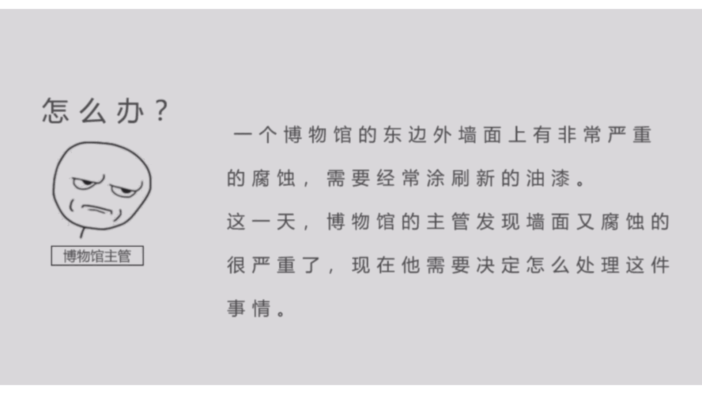

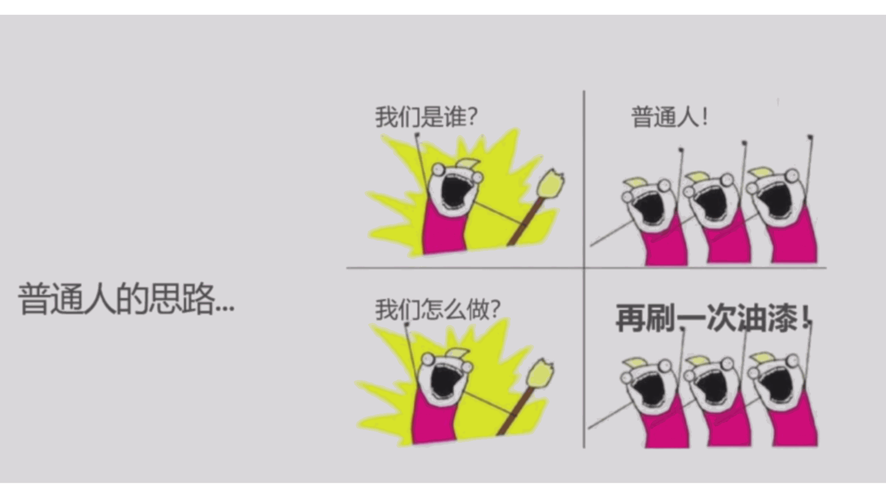

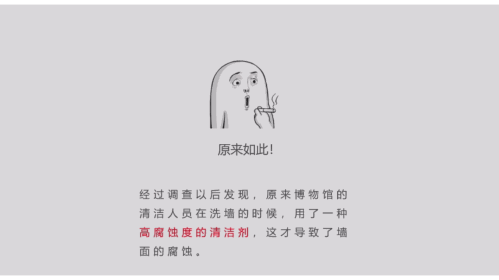

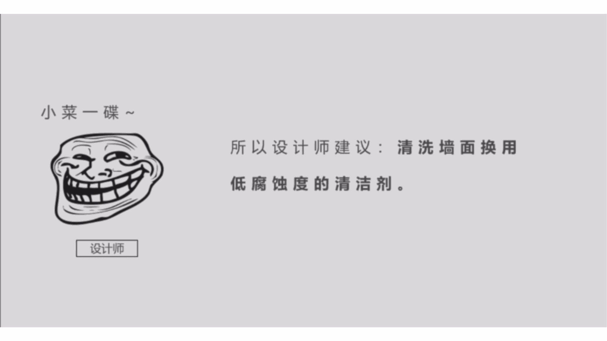

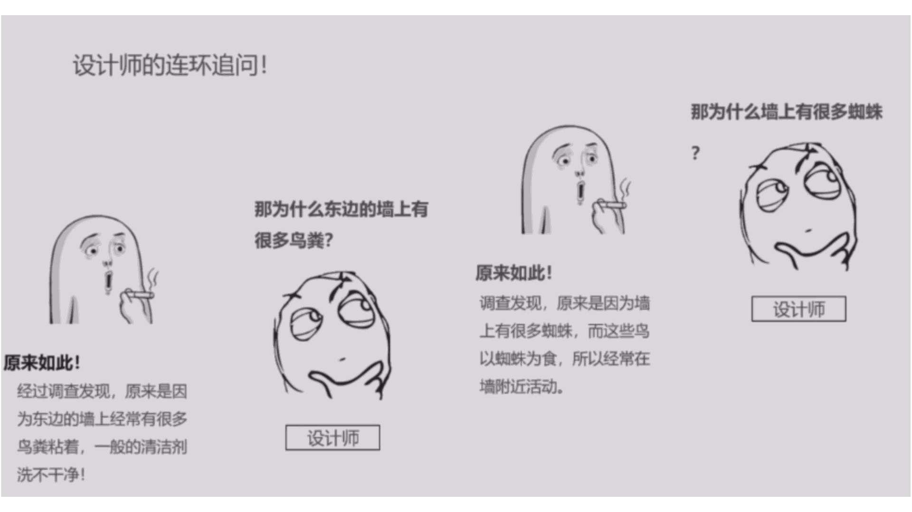

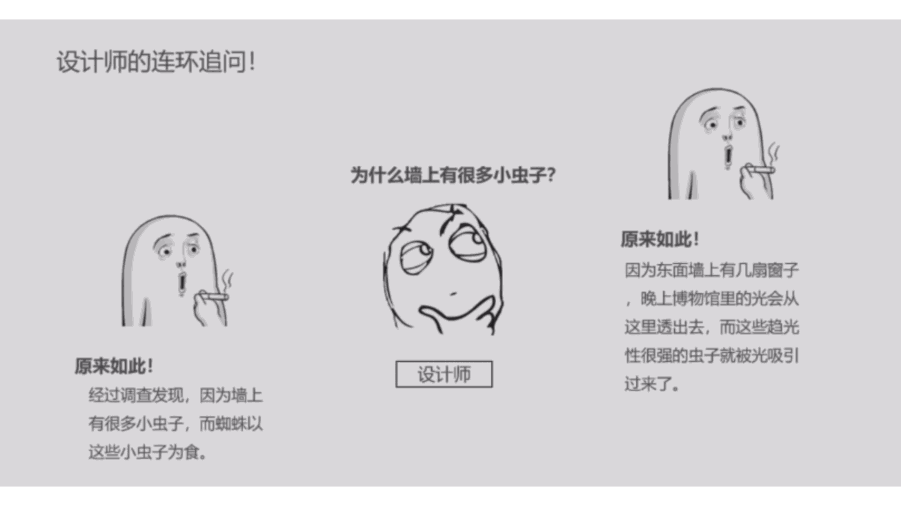

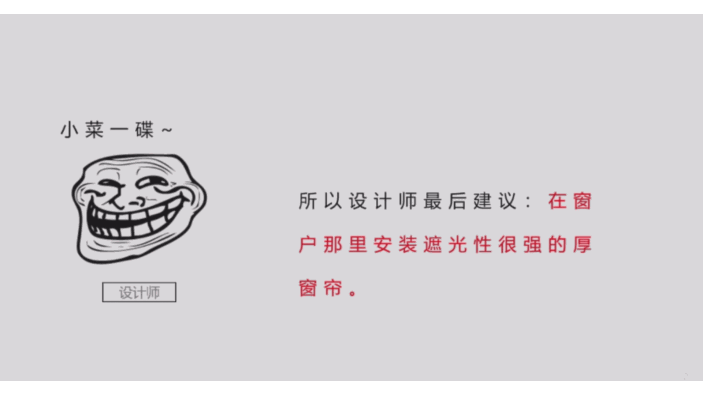

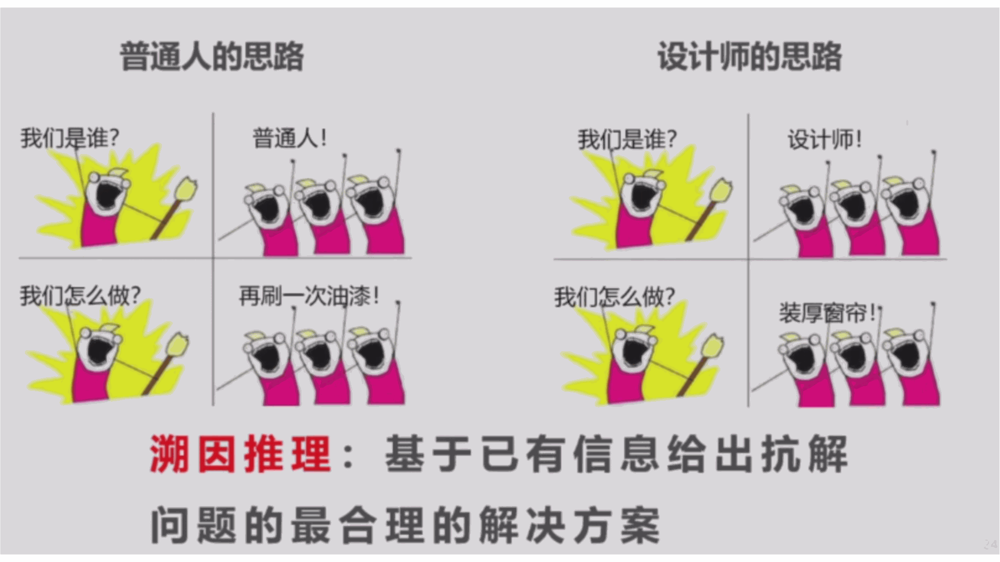

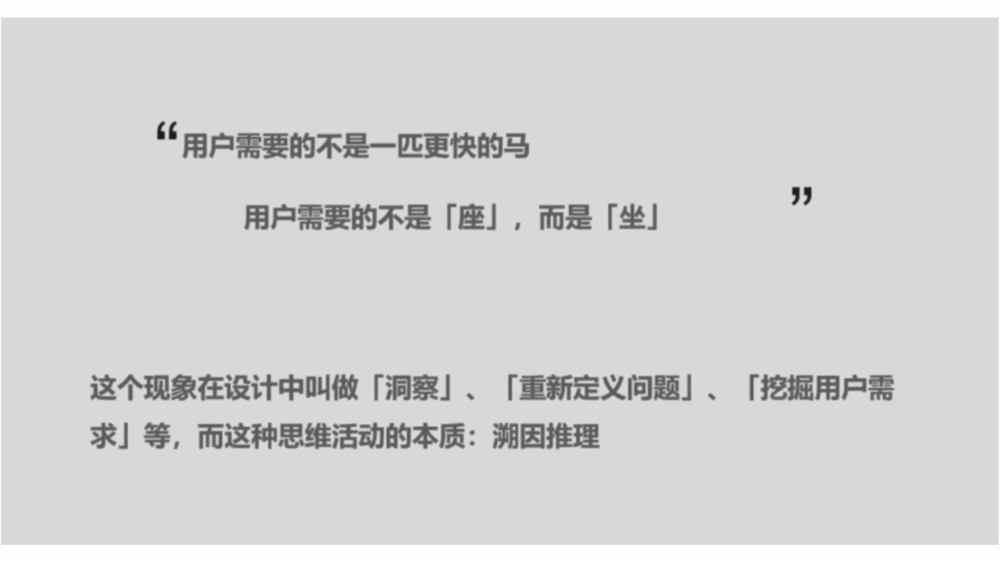

> 抗解问题 (Wicked Problem)：这是管理学、社会学里的一个词（通常译为“棘手问题”或“邪恶问题”）。它指的是那些**极其复杂、充满矛盾、没有标准答案、牵一发而动全身的问题**。

- 溯因推理讲的是从结果倒推原因。
    - 福特汽车创始人亨利·福特曾说：“用户需要的不是一匹更快的马”。
        - 表层要求是，用户说“我要一匹更快的马”。
        - 而本质上，用户其实是想“更快地从A地到达B地”。
        - **解决方案**：如果你只按字面意思去培育更快的马，你就输了；如果你提供一辆汽车，你就赢了。
    - “用户需要的不是「座」，而是「坐」”
        - 「座」代表具体的物件（比如一把椅子），「坐」代表一种状态和功能（比如休息、放松），用户买你的椅子，不是因为想要拥有这个木头架子，而是因为他想“舒服地坐下”。
- 由于第一性原理的存在，我们只能问到「不能再改变的那一层」
    > 这一层就是重新定义问题的核心——我们无法阻止阳光的照射，但我们却可以改变窗户和窗帘。

### 二、需求导向

#### 需求决定生产

- 在产品的开发周期中，需求决定生产。
    - 如果没有相应的需求，那么再好的功能也是白搭。
- 尽管这一点看起来十分简单，但当我们陷入复杂的逻辑，页面，交互之中，整天都在思考UX（User Experience，用户体验）、UI（User Interface，用户界面）和交互的时候，就很容易被自己对这个项目过多的了解带偏了方向，而忽视了用户的需求。身为产品经理，我们应时刻以需求为导向，避免陷入自我中心的旋涡。

#### 先做需求评估

- 在一个产品决定去设计UI之前，我们就应该对他的需求进行评估。
    - 用户是否真的需要？
    - 和其他竞品相比，我们满足了什么特殊的需求或解决了什么竞品中的痛点？
- 确认了这一步后，我们才应该去为它设计UI，设计交互。而不是等到万事俱备后才发现——用户好像并不需要我们的产品。

#### 如何确定需求

- 那么如何确定需求呢？
    - 需求本身就是一个主观的事情，你认为重要的可能在别人眼里并不重要，众口难调。又可能有不同的需求相互冲突，这时又该如何抉择呢？
    - 解决这个问题的方案之一就是**调研**：通过广度的调查和深度的访谈，既能够覆盖广度的需求，也能就核心需求调研相关用户的想法与需要。调研的具体方法我们不在这里详细展开。
        - 但我们也不能总是依赖调研，因为调研需要一定的用户时间成本，高频的调研可能会消磨用户对我们产品的耐心。
    - **实操测试**：在使用产品的过程中发现需求。
        > 比如【全潮事务管理板】【20261010】BBS更新公告&反馈收集 https://www.qsc.zju.edu.cn/bbs2/topic/1485 就会收集大家在使用BBS的过程中发现的bug或者需求。注意这和调研不同。
    - **数据分析**：我们可以在产品里埋点，做一些行为数据分析（比如说留存率、功能使用率等）
        > 事实上我们之前针对部分产品部署了sentry（**以开发者为中心的应用监控平台**，核心定位是**错误追踪**与**性能监控**）。不过这是很早之前的事情了后面也没怎么用上（

#### 对需求的判断

- 产品经理本人（当然，现在开发者们大多都是自己的产品经理）应把握需求的大方向。
    - 至于如何把握，某种程度上每个人都有自己的风格。需求的取舍是体现个人思维与能力的一个重要途径。
    - 一个普适的需求判断方案是不太能存在的。如果有了完全流水线化的评判策略，那么产品就会趋于同质化，缺乏亮点与新意，而创新正是当下的互联网产品（我想未来的也是）所需要的。
    - 所以，与其期望找到一个严格的规范，不如通过阅读，体验，思考不断提升自己的能力，加强对产品的把握力。

### 三、需求评估

> 接下来我们借用《产品从-1到0》里说到的例子，展开说说一些常见的评估需求的方式。

#### 案例：微信的 100M 文件限制

- 以总被大家诟病的微信文件限制100M为例，这一个功能上，用户的需求显然是——**需要上传更大的文件**。成本可能是存储空间，服务器带宽压力，需要根据具体的技术方案评估，我们无法得知。那么产品经理需要考虑什么呢？
    - ① 这个需求是否真实、是否只是个例？
        - 首先需要这个需求是否是个例。在我们身边的大学生群体中，吐槽这个的不在少数，但要知道大学生群体只是整体用户的一小部分，对于其他群体，这个需求是否还显著存在呢？毕竟对于只是用微信聊天的人来说，100M的文件大小限制可能已经够了。
    - ② 这个需求是否紧迫？
        - 其次这个需求是否紧迫？要知道我们的人力成本有限，无论是公司，你自己开发，或是求是潮开发都是如此。而想要新增的功能是多的，我们是否有必要抽调人力物力去满足这一需求呢？那么你首先会想到不满足会如何。大家也只不过会去使用云盘等替代品罢了，似乎没什么大不了的。如果这时有一个核心功能也在等待人力完成，那么你显然应该主要去实现核心功能。
    - ③ 我们能否满足这个需求？
        - 最后是我们能否满足这个需求。可能需求是好的，也是有必要的，但我们有足够的能力去彻底解决这一需求吗？技术方案上是否支持扩容，需要多大成本。又比如如果要加，100M要加到多少合适呢？用户总是贪得无厌的，今天嫌弃100M少，如果扩到500M，或许也会嫌少……
- 总之，不知道他们自己是如何想的，只是如果是我们，可能会从这些方面思考。最终的结果大家也知道了，100M的文件限制至今仍然存在。

#### 鉴别伪需求

- 尽管需求是由用户提出的，但这些需求也未必都是真实的，接下来讲解一个祖传的伪需求例子：
    - 学校的附近有一家旅馆，每逢周末就会有很多情侣入住，供不应求。老板问同学们你们是来做什么的呀？同学们说“是来学习的”。老板心想这学校附近的学习需求很大啊，如果我把宾馆改造成学习室，可以容纳更多的同学，那岂不是赚翻，随即动工。但改造成学习室后就无人问津了。
- 可见，在浩如烟海的需求中，我们也需要去伪存真。
    - 这就是为什么我们强调要”重新定义问题“

#### 需求的分级

- 我们的产品往往源自一个大的需求，以求是潮Mobile为例，主要是满足同学们校内资源查询的需求。
    - 那么这个大的需求也会被拆分为许多小的需求，如：查询课表，查询校车，查询考试时间，等等。
    - 小的需求往往是浩如烟海的，我们需要对需求进行分类与分级，评估各需求的重要性从而分配不同的资源：
        - 一方面是我们的人力资源，我们安排更多的开发者去解决重要的需求
        - 另一方面也是我们UI设计上的分配，对高频的需求需要更显著的位置
- 在Mobile的例子中，一眼就可以看出查询课表就是我们最重要的需求，它足够高频，每次上课前都要看，也足够有竞争力，App的方式相比于教务网查询节约了大量的步骤。
- 同时，围绕这个需求，我们可以扩展”距离上课/下课时间的提醒“等诸多功能

#### 广义的需求视角

- 当你把需求视角推广到生活中，也会为你带来许多。
    - 生活是由无数的选择构成的，当我们面临选择的时候，想清楚自己的需求是什么再做决定。小到为自己选购一台电脑，大到学习，专业，去向这样人生轨迹上的选择，都可以帮助你许多。
    - 当你每做一个决定，产品上或生活上的，请先三思——这个决定为了什么，这个决定是否有用。这或许能时刻提醒你牢记以需求为导向，让你更好地掌控自己的产品或生活。

## 协作

> 以下内容你可能会觉得很无聊，但某种意义上这些知识是必要的。也算是纪念一下消失的”产品运营部门“:)

### 一、沟通

#### 什么是有效沟通

- 什么是有效沟通？
    - 用正确的形式，在正确的时间，给正确的受众，施以正确的影响。

#### 沟通的规划与监督

- 规划沟通
    - 输入：章程/计划/文件/环境/资产
    - 工具技术：需求分析/技术/模型/方法/数据/会议
    - 输出：沟通计划/计划更新/文件更新
    - 一图言之：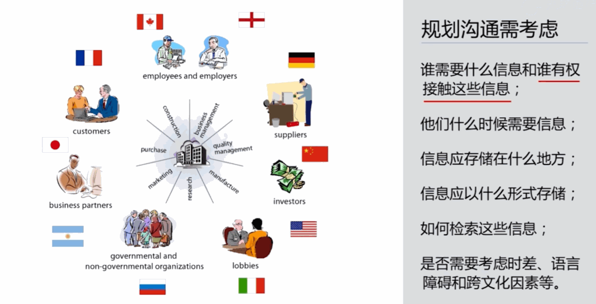
- 监督沟通
    - 确保项目信息及时恰当地规划、收集、生成、发布、储存、管理、控制、监督、处置

#### 为什么沟通会失真

- 乔哈里窗：透视沟通双方的信息差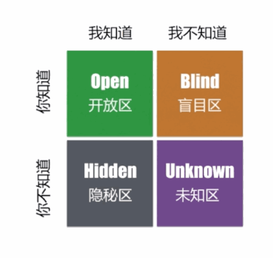
    - 四象限——我知道且你知道（Open 开放区）、你知道我不知道（Blind 盲目区）、我知道你不知道（Hidden 隐秘区）、都不知道（Unknown 未知区）。
    - 协作里最容易出事的是「我以为对方知道」
    - 信息同步很重要
- 沟通漏斗
    - 漏斗这个概念会伴着产品经理整个职业生涯，产品经理要学会在埋点中建立漏斗模型，通过分析每一层漏斗的数据来推导业务是哪里出了问题，怎么改进。
    - 沟通中的漏斗模型也很好理解：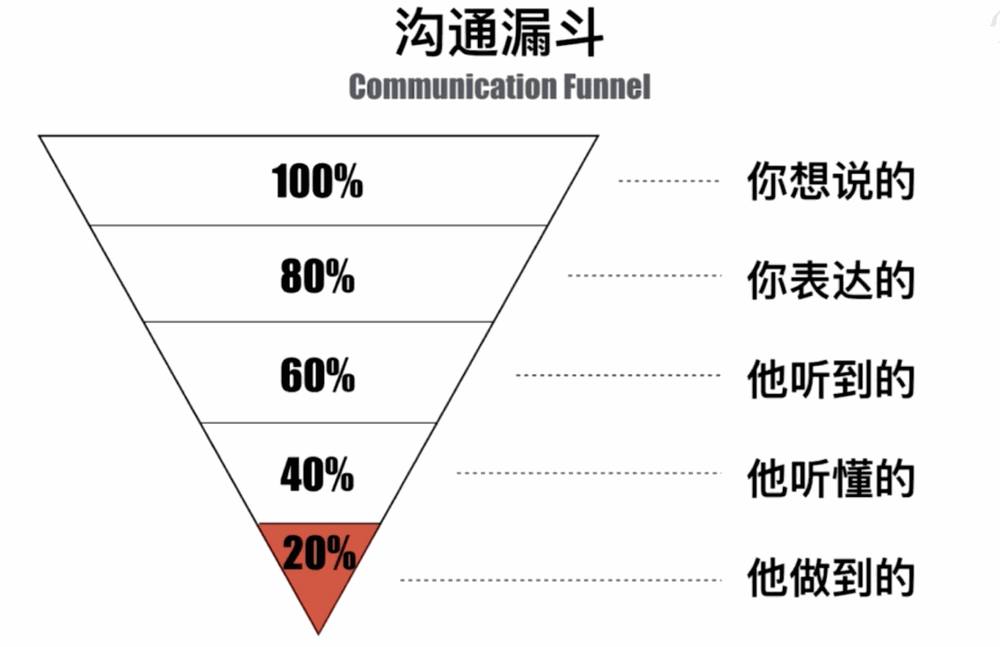
    - 提升沟通质量和效率的根本之道就在于把每一层漏斗的损耗尽量降低。拿图中的100%-80%这个阶段举例就是，要提升自己的语言表达能力，尽量把自己想说的准确、完整说出来，80%-60%则是考验你的表达技巧，例如可以借助图文结合、简练表达等方式来优化，有时候也受到环境的影响。
- 信息链路
    - 这个概念很好理解，正常情况下，有多少人就有多少个组合出来的链路。
    - 所以如何处理和优化就成了提升效率的重要问题。
    - 图中，5 个人两两相连共 10 条链路，团队人数增加时，沟通链路数就会按平方增长——这就是「加一个人不是多一条线」的原因。
    - 传统的管理方式大部分是多层级管理
        - 这样能减少链路，但漏斗的层数太多，每一层传递都会丢失信息
        - 扁平管理能减小漏斗，但会增加链路
            - 有的公司会采用较扁平的方式，例如用团队的方式管理，每个团队一个Team Leader，这个团队里如何工作都由团队自己决定，团队内部一般不设层级
            - 一些大公司会采用团队+小微组织的方式管理，把层级控制在较少的程度

#### 沟通中常见的障碍

- 常见的障碍
    - 信息过载：一次讲太多
    - 知识缺乏：说话者或者接收者知识水平不够
    - 文化差异：受文化影响的理解差异
    - 环境影响：在茶水间上、工位上、会议室里等环境条件会造成影响
    - 有害态度：认为对方在说谎、不居好心、不如自己等情况
    - 情绪：比如愤怒
    - 不懂术语：例如产品和别人沟通的时候别人不懂ROI、MRR之类的术语，或者产品和技术沟通的时候不懂技术说的一些术语；此处强调，产品不一定需要懂技术，但是要通过沟通和学习知道技术在做什么、能做什么
    - 渠道复杂：信息传递链节太多，或者使用的沟通平台不统一等
    - 选择性认知：比如只听别人夸自己的，不听别人批评的
- 障碍的原因（偏组织层面）
    - 不同位置的人对项目目标的理解不同
    - 资源的有限及分配
    - 人员之间的个人冲突
    - 对变化的抵制（对新技术、新流程）

#### 沟通方式与沟通技术

- 沟通方式
    - 交互式沟通（比如面聊）
    - 推式沟通（比如群发消息、邮件等）
    - 拉式沟通（把信息放在云端、共享空间、信息流等，接收者主动获得）
- 沟通技术
    - 简化运用语言
    - 视觉辅助手段（图文结合、PPT等）
    - 积极倾听
    - 有效反馈
    - 情绪控制
- 书面沟通的 5C 原则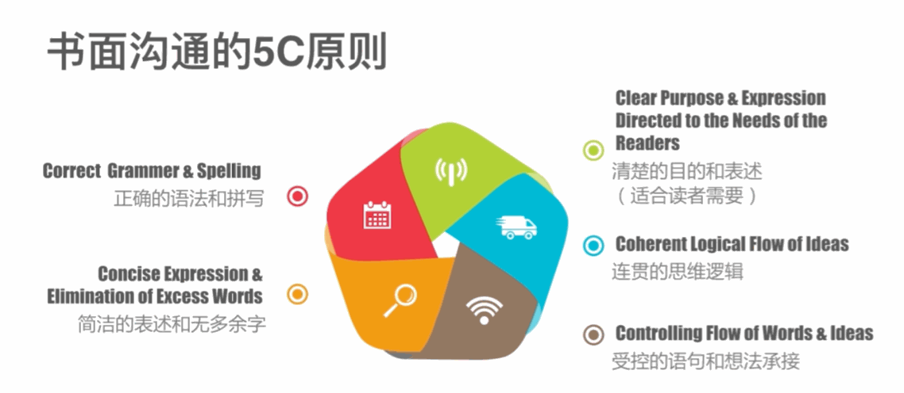
    - **C**lear Purpose & Expression Directed to the Needs of the Readers → 清楚的目的和表述（适合读者需要）
    - **C**oherent Logical Flow of Ideas → 连贯的思维逻辑
    - **C**ontrolling Flow of Words & Ideas → 受控的语句和想法承接
    - **C**orrect Grammer & Spelling → 正确的语法和拼写
    - **C**oncise Expression & Elimination of Excess Words → 简洁的表述和无多余字

### 二、表达与交流

[2021.3.24 内训 · 表达与交流](assets/requirements-and-collaboration/2021-03-24-internal-training-expression.pdf)

### 三、如何提问？

- 首先你要敢于提问:)
- 欢迎阅读[《提问的智慧》](https://github.com/tvvocold/How-To-Ask-Questions-The-Smart-Way)
- 省流：
    - 先搜再问
    - 给出上下文
    - 说明已尝试过什么
    - 描述可复现的现象
    - 一次把问题讲完
- 反面例子：只发一句「在吗」「有个问题」，然后等对方回

### 四、协作工具的选择

- git
    - 分布式版本控制系统
    - 所有的变更都是可追溯、可审查、可回退的
    - 学习曲线陡峭，对“实时同时编辑”的需求不友好
- 飞书
    - 一站式企业协作平台
    - 可用于互联网/产品团队的日常协作、远程办公、知识库搭建
    - 体系较重，深度使用需要统一的管理规范和培训成本
- Notion、钉钉、腾讯文档...
- Fine，选什么工具还是要看你使用的场景

### 五、分锅和 AI slop

- 提到团队协作，现在不得不说的话题就是"分锅怎么分"和"如何不做出AI slop（AI泔水）"。
- **分锅**
    - 按模块分
    - 按 Use Case 分
        - 一个功能从需求到上线全归一个人
    - 按阶段分
        - 一人写需求、一人 Review
- **AI slop**
    - 判断标准
        - 讲不清逻辑/过度设计痕迹明显
    - 落地要求
        - AI 产出必须有人 Review、必须能解释、必须有测试
    - 团队约定
        - 你不能一切都交给 AI 直接生成

## 参考文献

- 【产研 | 产品】【产品内训资料汇总】 https://www.qsc.zju.edu.cn/bbs2/topic/81 复制本链接，打开【QSCBBS】网页端，直接查看本帖！
    - 2021.3.24内训by18禁
- 飞书知识库-产研内训资料
