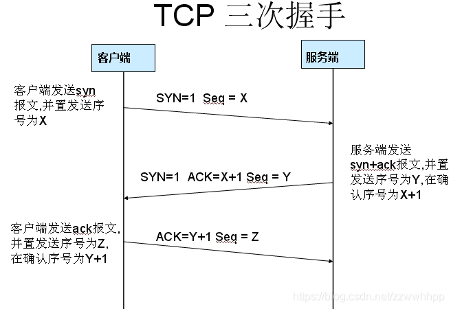

# Wireshark简介

> 原作者：@马瑀涵
>
> 修改：@翁祖翔

**拓展/参考阅读**

- Wireshark 在 CTF 中的使用：

  - [Wireshark \- CTF Wiki](https://ctf-wiki.org/misc/traffic/protocols/wireshark/)

  - [流量分析 \- Hello CTF](https://hello-ctf.com/hc-misc/pcap/#wireshark)

- 官方文档：https://www\.wireshark\.org/learn

- [网络分析工具——WireShark的使用\(超详细\)\-CSDN博客](https://blog.csdn.net/zzwwhhpp/article/details/113077747)

## 一、Wireshark 是什么？

Wireshark 是一个**免费开源的网络数据包分析工具**，被誉为“网络分析界的瑞士军刀”。它可以捕获网卡上传输的所有数据包，并逐层解析协议内容，让“看不见摸不着”的网络通信变得直观可见。

**一句话概括**：给网线装一个“听诊器”，让所有数据包无处遁形。

---

## 二、了解Wireshark有什么用？

### 2\.1 让抽象理论“可视化”

- TCP 三次握手、DNS 解析、HTTP 请求/响应等理论，都可以在 Wireshark 中亲眼看到

  > - TCP 三次握手是什么？
  >
  >     **第一步**：客户端发送一个 SYN=1，ACK=0 标志的数据包给服务端，请求进行连接，这是第一次握手；
  >
  >     **第二步**：服务端收到请求并且允许连接的话，就会发送一个SYN=1，ACK=1标志的数据包给发送端，告诉它，可以通讯了，并且让客户端发送一个确认数据包，这是第二次握手；
  >
  >     **第三步**：服务端发送一个 SYN=0，ACK=1 的数据包给客户端，告诉它连接已被确认，这就是第三次握手。TCP连接建立，开始通讯。
  >
  > 
  >
  > - DNS 解析是什么？
  >
  >   - DNS 解析是把我们输入的“域名”，翻译成电脑能懂的 “IP 地址” 的过程。

- 将协议栈分层（物理层→链路层→网络层→传输层→应用层）以实际数据包形式呈现

### 2\.2 解决日常网络问题

- 宿舍网络卡顿：抓包查看是延迟高还是丢包

- 怀疑被蹭网/ARP欺骗：抓包找大量异常广播包

- 程序连不上服务器：抓包定位连接被重置的原因

### 2\.3 打下网络安全基础

- 理解为什么 HTTP 明文传输不安全

- 为后续学习网络攻防、流量分析做准备

---

## 三、网络协议分层基础（TCP/IP 模型）

在深入使用 Wireshark 之前，需要先理解网络数据是如何分层组织的。**TCP/IP 模型**是最常用的网络模型，共分四层，Wireshark 的“数据包详情区”就是按照这个顺序从下往上展示的。

### 3\.1 四层模型与作用

| 层级  | 名称        | 作用                    | Wireshark 中对应的协议    | 日常类比                        |
| --- | --------- | --------------------- | ------------------- | --------------------------- |
| 4   | **应用层**   | 为应用程序提供网络服务，规定数据格式    | HTTP、DNS、FTP、SSH    | 寄信时信纸上写的“内容”和“格式”（比如中文还是英文） |
| 3   | **传输层**   | 提供端到端的通信，保证数据可靠或高效    | TCP、UDP             | 快递公司的“服务类型”（普通快递还是特快专递）     |
| 2   | **网络层**   | 负责寻址和路由，把数据从源头发送到目的地  | IP（IPv4/IPv6）、ICMP  | 快递单上的“收件人地址”（决定包裹往哪个城市送）    |
| 1   | **网络接口层** | 处理物理硬件（网卡、网线）和 MAC 地址 | Ethernet、Wi\-Fi、ARP | 快递的“运输工具”（货车、飞机）和“派送员”      |

### 3\.2 数据包的“洋葱结构”

网络数据在发送时，每一层都会在数据外面**包上一层自己的头**（就像快递单、包装盒、填充物）。接收时，每一层再把自己的头拆掉。

**示例**：你在浏览器输入 `http://example.com`，按下回车后：

1. **应用层**：浏览器构造 HTTP 请求头（GET /index\.html）

2. **传输层**：加上 TCP 头（源端口随机，目标端口 80，序列号等）

3. **网络层**：加上 IP 头（源 IP 你的电脑，目标 IP example\.com 的服务器 IP）

4. **网络接口层**：加上 Ethernet 头（源 MAC 你的网卡，目标 MAC 网关的 MAC）

最终变成一个**二进制流**，通过网线或 Wi\-Fi 发送出去。

在 Wireshark 中，你从“数据包详情区”自上而下看到的顺序正好是：Frame → Ethernet → IP → TCP → HTTP，这就是从物理层到应用层的**解包过程**。

### 3\.3 关键术语解释

| 术语          | 含义                    | 通俗理解               |
| ----------- | --------------------- | ------------------ |
| **MAC 地址**  | 网卡的物理地址，出厂时烧录，全球唯一    | 身份证号（一生不变）         |
| **IP 地址**   | 设备在网络中的逻辑地址，可动态变化     | 快递地址（搬家后会变）        |
| **端口号**     | 区分同一台设备上的不同应用程序       | 大楼里的门牌号            |
| **TCP**  | 面向连接的可靠协议，保证数据不丢失、不乱序 | 打电话（先拨号建立连接，通话，挂断） |
| **UDP**     | 无连接的不可靠协议，速度快但不保证到达   | 寄明信片（扔进邮筒就不管了）     |
| **DNS**     | 域名系统，把域名翻译成 IP 地址     | 电话本：输入名字查号码        |

---

## 四、安装与准备

### 4\.1 下载

- 官网：https://www\.wireshark\.org/download\.html

- 根据操作系统选择对应版本

### 4\.2 安装注意事项（Windows）

- 安装过程中会出现 **Npcap** 组件安装提示，**必须勾选并安装**

- 若提示“WinPcap 已安装但不再支持”，请先卸载 WinPcap，再安装 Npcap（勾选“WinPcap API\-compatible Mode”）

- [Npcap下载官网](https://npcap.com/)

- 安装完成后**建议重启电脑**，使驱动生效

### 4\.3 验证安装成功

- 打开 Wireshark，能看到一张网卡列表（如“以太网”、“Wi\-Fi”），表示安装成功

### [超详细的 Wireshark 抓包使用教程](https://www.cnblogs.com/clnchanpin/p/19440477)

---

## 五、Wireshark 核心概念

### 5\.1 两大过滤器

| 类型        | 作用时机  | 典型场景          | 示例                       |
| --------- | ----- | ------------- | ------------------------ |
| **捕获过滤器** | 抓包前设置 | 减少抓包文件大小，提升效率 | `tcp port 80`            |
| **显示过滤器** | 抓包后筛选 | 从海量数据中精准定位    | `ip.addr == 192.168.1.1` |

> **小技巧**：右键点击数据包详情区的某个字段 → “作为过滤器应用”，可直接生成过滤条件，无需死记硬背。

### 5\.2 三大主界面区域

1. **数据包列表区**：展示每个数据包的编号、时间戳、源/目标地址、协议、长度、信息摘要。

2. **数据包详情区**：按协议层展示（Frame → Ethernet → IP → TCP/UDP → HTTP/DNS 等），**分析核心所在**。

3. **数据包字节区**：原始十六进制和 ASCII 码显示。

---

## 六、实战操作流程

### 6\.1 第一步：选择正确的网卡

- 打开 Wireshark，观察每个网卡旁边的**波形图（实时流量波动条）**

- 哪个波形在跳动，就说明该网卡正在收发数据

- **双击正在使用的网卡**，开始抓包

### 6\.2 第二步：产生网络流量

- 打开浏览器，访问一个**不强制跳转 HTTPS 的网站**，例如 `http://example.com` 或 `http://httpbin.org`

- ⚠️ 不要用百度、谷歌等 HTTPS 网站，否则抓到的是加密包，看不到内容

### 6\.3 第三步：停止抓包

- 页面加载完成后，点击工具栏的**红色方形按钮**（停止抓包）

### 6\.4 第四步：使用显示过滤器

- **筛选 DNS 包**：在过滤器框输入 `dns` → 回车，看到域名解析请求和响应

- **筛选 HTTP 包**：输入 `http` → 回车，只显示 HTTP 协议的数据包

### 6\.5 第五步：分析一个 HTTP 包

1. 在数据包列表中选择一个 `HTTP 200 OK` 响应包

2. 在**数据包详情区**逐层展开，观察：

   - **Frame**：物理层，整个帧的长度、捕获时间

   - **Ethernet II**：数据链路层，源/目标 MAC 地址

   - **Internet Protocol**：网络层，源/目标 IP 地址

   - **Transmission Control Protocol**：传输层，源/目标端口、序列号、标志位

   - **Hypertext Transfer Protocol**：应用层，状态码、响应正文

### 6\.6 第六步：Follow TCP Stream（还原完整对话）

1. 右键任意一个 HTTP 请求或响应包

2. 选择 **Follow** → **TCP Stream**

3. 弹出窗口显示：

   - 红色内容：客户端发送的数据（如 `GET / HTTP/1.1`）

   - 蓝色内容：服务器返回的数据（如 HTTP 响应头 \+ HTML 页面）

4. **安全提示**：不加密的 HTTP 协议下，抓包者可直接看到你的所有通信内容——这就是为什么公共 Wi\-Fi 上不要输入密码。

### 6\.7 第七步：保存抓包文件（可选）

- 菜单栏 **File** → **Save As** → 保存为 `.pcapng` 文件

---

## 注：Wireshark 数据包颜色标识详解

Wireshark 使用**着色规则（Coloring Rules）** 为不同协议或状态的数据包标记颜色，帮助用户在数据包列表中快速识别和定位关注的信息。

### 1、颜色规则的作用

- 默认情况下，Wireshark 内置了一套着色规则，根据数据包的**协议类型**、**标志位**或**专家信息**自动分配颜色。

- 你可以在菜单栏 **视图 \(View\) → 着色规则 \(Coloring Rules\.\.\.\)** 中查看、修改或自定义所有规则。

### 2、常见默认颜色及其含义

下表列出了一些常见的内置颜色含义（不同 Wireshark 版本可能略有差异）：

| 颜色示例            | 常见含义         | 详细说明                                    |
| --------------- | ------------ | --------------------------------------- |
| 🟢 **绿色**       | 正常 TCP 数据包   | 最常见的普通 TCP 通信流量。                        |
| 🔵 **浅蓝色**      | UDP 数据包      | 例如 DNS 查询、DHCP 等基于 UDP 的协议。             |
| 🔵 **深蓝色**      | DNS 协议流量     | 专门用于标记 DNS（域名系统）的请求和响应。                 |
| 🟣 **淡紫色**      | TCP 连接管理包    | 如 TCP 三次握手中的 SYN 包、连接关闭时的 FIN 包等控制信息。   |
| 🔴 **红色**       | TCP 重置包（RST） | 表示连接被突然关闭或拒绝，通常意味着网络问题或服务拒绝。            |
| ⚫ **黑色背景/红色文字** | 协议错误或问题包     | 例如 TCP 重传、乱序、丢包等异常情况，由 Wireshark 分析后标记。 |
| 🟡 **黄色背景**     | 专家信息警告       | 提示应用层错误（如 HTTP 404）或协议规范违反等需要注意的事件。     |

> **注意**：颜色规则是按顺序应用的，**第一条匹配的规则将决定数据包的颜色**，后续规则不再覆盖。因此，如果一个数据包同时满足多条规则，只会显示最先匹配的那条颜色。

### 3、如何自定义颜色规则

你可以根据需要添加、修改或删除颜色规则，以便突出显示特定流量。

1. **打开着色规则窗口**
   菜单栏：**视图 \(View\) → 着色规则 \(Coloring Rules\.\.\.\)**

2. **新增规则**

   - 点击 **\+** 按钮

   - 在 **Name** 字段输入规则名称（如“我的HTTP流量”）

   - 在 **Filter** 字段输入显示过滤器表达式（例如 `http`）

   - 点击 **Foreground**（前景色/文字颜色）和 **Background**（背景色）按钮选择颜色

   - 点击 **OK** 保存

3. **编辑或删除规则**

   - 选中已有规则，点击 **Edit\.\.\.** 进行修改，或点击 **\-** 按钮删除

4. **调整规则优先级**

   - 规则按列表**从上到下**的顺序匹配。你可以通过 **Up** 和 **Down** 按钮调整规则顺序，将更重要的规则放在前面。

### 4、使用颜色进行快速诊断

- **大量黑色或红色包**：通常表示网络存在丢包、延迟、拥塞或连接被拒绝等问题，需要进一步分析时间戳和对应流。

- **大量黄色背景包**：提示可能存在应用层错误（如服务器返回 404）或协议不规范行为。

- **青蓝色背景（专家信息 Note 级别）**：提示需要注意的事件，例如 HTTP 重定向或非致命错误。

### 5、重置默认颜色规则

如果你修改后想恢复 Wireshark 的出厂颜色设置，可以：

- 打开 **着色规则** 窗口

- 点击 **Reset** 按钮（将所有规则恢复为安装时的默认状态）

---

通过理解并善用颜色规则，你可以成倍提升分析数据包的效率，快速从海量流量中定位异常或关键信息。

## 七、日常生活实用场景与做法

Wireshark 不只是用于学习或专业工作，它也能辅助解决我们日常生活中遇到的很多网络问题。以下是几个典型场景和具体的操作步骤。

### 7\.1 场景一：网络突然变卡，玩游戏延迟飙升

**可能原因**：某些进程在大量上传/下载占用带宽，或者网络中存在大量重传（信号干扰/网线接触不良）。

**Wireshark 排查步骤**：

1. 在卡顿的时候，打开 Wireshark 抓包 30 秒

2. 停止抓包，在显示过滤器输入 `tcp.analysis.retransmission` → 回车

3. **观察结果**：

   - 如果有大量重传包 → 说明网络质量差，可能是 Wi\-Fi 干扰或网线问题

   - 如果没有重传但依然卡 → 可能是带宽被占满，可以限制程序占用

### 7\.2 场景二：怀疑有人在进行 ARP 欺骗

**ARP 欺骗是什么**：攻击者发送伪造的 ARP 包，告诉路由器“我是你”（把网关的 IP 映射到攻击者的 MAC），于是你的所有流量都先经过攻击者的电脑，他就可以窃听甚至篡改数据。

**Wireshark 检测步骤**：

1. 抓包几分钟（建议在晚上大家都在使用时抓）

2. 在显示过滤器输入 `arp` → 回车，只查看 ARP 包

3. **观察异常**：

   - 正常情况下，ARP 包应该是“谁有 192\.168\.1\.1？请告诉 192\.168\.1\.100”

   - 如果看到大量 `192.168.1.1 is at XX:XX:XX:XX:XX:XX` 来自**不同 MAC 地址**，或者同一个 IP 对应多个 MAC，说明有人在欺骗

4. **进一步确认**：输入 `arp.duplicate-address-detected` 或观察是否有 `arp.opcode == 2`（回复包）频繁且异常

5. **解决办法**：

   - 修改路由器管理员密码、Wi\-Fi 密码，开启 WPA2/WPA3 加密

   - 绑定 IP\-MAC 静态映射（在路由器设置中）

   - 使用 `arp -s` 命令手动绑定网关的 MAC（临时措施，重启失效）

### 7\.3 场景三：某个网站或游戏服务器突然连不上了

**可能原因**：连接被重置、服务器无响应、DNS 解析失败等。

**Wireshark 排查步骤**：

1. 清空浏览器缓存，启动 Wireshark 抓包

2. 访问打不开的网站

3. 停止抓包，输入显示过滤器 `http` 或 `dns`

4. **判断故障点**：

   - 如果看到 `DNS Standard query` 但没有响应 → DNS 服务器问题

   - 如果看到 `TCP SYN` 多次重传（红色标记）但无 `SYN-ACK` → 服务器不通或防火墙拦截

   - 如果看到 `TCP RST`（重置包） → 连接被对方主动拒绝（可能是 IP 被屏蔽）

   - 如果看到 `HTTP 404/500` → 网站本身问题，不是你网络的问题

5. **解决办法**：

   - DNS 问题：换用 `8.8.8.8` 或 `114.114.114.114`

   - TCP 不通：检查防火墙、代理设置；尝试 ping 服务器 IP 看是否通

   - 被重置：可能需要更换网络环境或使用 VPN

### 7\.4 场景四：想知道某个 App 在后台偷偷上传什么数据

**做法**：

1. 手机上开启热点，让电脑连接该热点，在电脑上用 Wireshark 抓包（手机流量会经过电脑）

2. 或者直接在电脑上安装模拟器，在模拟器里运行 App，然后抓包

3. 过滤出 `http` 或 `tcp.port` 常见端口（80, 443, 8080）

4. Follow TCP Stream 查看明文内容（如果是 HTTPS，只能看到域名，内容加密）

**注意**：未经允许抓取他人流量涉及隐私问题，请仅用于自己的设备。

### 7\.5 场景五：检测自己电脑是否有异常外联（疑似中毒）

**做法**：

1. 关闭所有正常上网的程序（浏览器、游戏、聊天软件）

2. 打开 Wireshark 抓包 5\-10 分钟

3. 显示过滤器输入 `tcp.flags.syn == 1 && tcp.flags.ack == 0`（只查看主动发起的 SYN 请求）

4. 检查这些 SYN 包的目标 IP 是否陌生，尤其是国外 IP 或非知名端口

5. 用 `nslookup` 或在线工具查询该 IP 的域名，如果是已知的 C2 服务器（僵尸网络控制端），则可能中毒

**注意**：Windows 系统本身会有一些后台服务（如时间同步、更新检测）产生正常外联，不要误判。

---

## 八、常用显示过滤器速查

| 目的                 | 过滤器表达式                                     |
| ------------------ | ------------------------------------------ |
| 只看 HTTP 协议         | `http`                                     |
| 只看 DNS 协议          | `dns`                                      |
| 只看 ARP 协议          | `arp`                                      |
| 只看来自某 IP 的数据       | `ip.src == 192.168.1.100`                  |
| 只看发往某 IP 的数据       | `ip.dst == 8.8.8.8`                        |
| 只看某端口（如 80）        | `tcp.port == 80`                           |
| 只看 TCP 重置包（连接被拒绝）  | `tcp.flags.reset == 1`                     |
| 只看重传包（网络卡顿信号）      | `tcp.analysis.retransmission`              |
| 只看 TCP 三次握手的 SYN 包 | `tcp.flags.syn == 1 && tcp.flags.ack == 0` |
| 组合条件（与）            | `ip.src == 192.168.1.100 and http`         |
| 排除某 IP             | `ip.addr != 192.168.1.1`                   |

---

## 九、常见问题与解决

| 问题                     | 原因                    | 解决办法                                          |
| ---------------------- | --------------------- | --------------------------------------------- |
| 网卡列表为空                 | Npcap 未安装或驱动未加载       | 重新运行 Wireshark 安装程序，勾选 Npcap；或手动安装 Npcap      |
| 双击网卡后无数据包              | 选错网卡 / 无权限            | 换一个网卡；Windows 以管理员身份运行 Wireshark              |
| 输入 `http` 过滤器后无结果      | 访问的网站强制跳转 HTTPS       | 改用 `http://example.com`或`http://neverssl.com` |
| Follow TCP Stream 窗口乱码 | 内容为 gzip 压缩或 HTTPS 加密 | 换不压缩的 HTTP 网站                                 |
| 抓不到本地回环包（127\.0\.0\.1） | 默认网卡不支持 Loopback      | 安装 Npcap 时勾选“支持回环抓包”；macOS 选择 `lo0` 接口        |
| 过滤后列表为空                | 过滤器语法错误或没有匹配的包        | 检查过滤器是否输错（例如 http 误写成 htt），清除过滤器重试            |

---

## 十、拓展高级功能

| 场景                  | 操作                                       |
| ------------------- | ---------------------------------------- |
| **统计协议占比**          | Statistics → Protocol Hierarchy          |
| **找出占用带宽最多的 IP**    | Statistics → Conversations → 按“Bytes”列排序 |
| **快速定位连接故障**        | 显示过滤 `tcp.flags.reset == 1`，找到被重置的连接     |
| **分析延迟和丢包**         | 显示过滤 `tcp.analysis.retransmission`，筛选重传包 |
| **绘制 IO 图表**        | Statistics → I/O Graph，可以看流量随时间变化的波形     |
| **导出特定流量的内容**       | Follow TCP Stream 后，选择“Save as…”保存原始数据   |
| **解析 TLS 流量（需要密钥）** | 设置环境变量 SSLKEYLOGFILE，然后在 Wireshark 中导入   |

---

## 十一、总结

- Wireshark 的核心是**过滤器**，掌握它就掌握了大半功能

- 通过抓包直观理解网络分层、协议交互、HTTP/HTTPS 原理

- 日常可用来排查网络卡顿、检测蹭网/欺骗、分析软件行为、定位服务器故障

- **核心操作/过滤器**：`dns`、`http`、`ip.addr ==`、`tcp.port ==`、`tcp.analysis.retransmission`、Follow TCP Stream

> **尝试**：用 Wireshark 抓一次访问 `http://example.com` 的完整过程，找到 DNS 查询包的响应时间，以及 HTTP 响应中的状态码和 Server 字段。然后尝试抓一下自己电脑的卡顿时段，看看有没有重传包。
